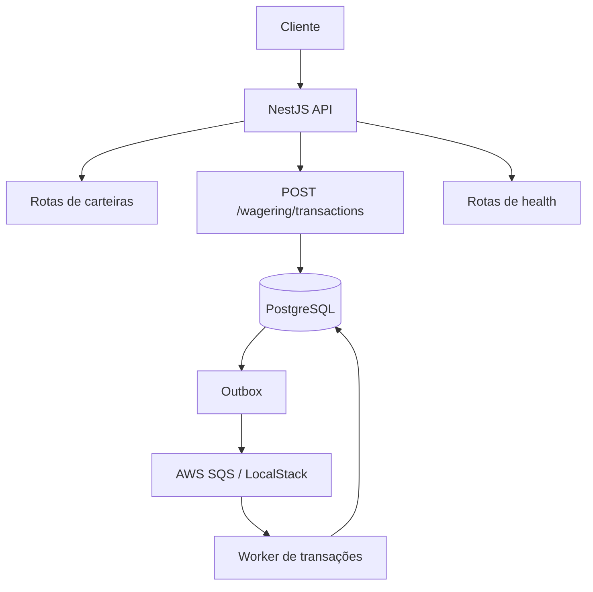

# Distributed Wagering Processor

Processador distribuído de transações usando Bun, TypeScript, NestJS, PostgreSQL, MikroORM e AWS SQS via LocalStack.

## Executar localmente

Requisitos: Bun 1.x, Docker e Docker Compose. 

Configure seu token no [LocalStack](https://app.localstack.cloud/).

```bash
bun install
cp .env.example .env
```

No Windows PowerShell:

```powershell
Copy-Item .env.example .env
```

Configure `LOCALSTACK_AUTH_TOKEN` no `.env`. Não versione esse arquivo.

```bash
docker compose up -d
bun run migration:up
bun run start:dev
```

API: `http://localhost:3000`.

## Rotas

### `POST /wallets`

Cria uma carteira.

**Body**
```json
{
  "playerId": "550e8400-e29b-41d4-a716-446655440000",
  "initialBalance": {
    "amount": "1000.00",
    "currency": "BRL"
  }
}
```

**Resposta `201 Created`**
```json
{
  "id": "550e8400-e29b-41d4-a716-446655440001",
  "playerId": "550e8400-e29b-41d4-a716-446655440000",
  "balance": {
    "amount": "1000.00",
    "currency": "BRL"
  },
  "version": 1,
  "createdAt": "2026-10-12T12:00:00.000Z",
  "updatedAt": "2026-10-12T12:00:00.000Z"
}
```

`409 Conflict` — carteira já existente para jogador e moeda:
```json
{
  "message": "A wallet already exists for this player and currency"
}
```

`400 Bad Request` — body inválido:
```json
{
  "message": "Validation failed",
  "issues": []
}
```

O array `issues` contém os detalhes da validação que falhou.

### `GET /wallets/:walletId`

Consulta uma carteira.

**Resposta `200 OK`**
```json
{
  "id": "550e8400-e29b-41d4-a716-446655440001",
  "playerId": "550e8400-e29b-41d4-a716-446655440000",
  "balance": {
    "amount": "1000.00",
    "currency": "BRL"
  },
  "version": 1,
  "createdAt": "2026-10-12T12:00:00.000Z",
  "updatedAt": "2026-10-12T12:00:00.000Z"
}
```

`404 Not Found`:
```json
{
  "message": "Wallet not found"
}
```

### `GET /wallets/:walletId/ledger`

Consulta o histórico de lançamentos.

**Query params**
- `limit`: quantidade por página, de `1` a `100`; padrão `50`.
- `cursor`: cursor retornado pela página anterior.

Exemplo: `GET /wallets/550e8400-e29b-41d4-a716-446655440001/ledger?limit=20`

**Resposta `200 OK`**
```json
{
  "entries": [
    {
      "id": "550e8400-e29b-41d4-a716-446655440002",
      "walletId": "550e8400-e29b-41d4-a716-446655440001",
      "transactionId": "550e8400-e29b-41d4-a716-446655440003",
      "direction": "CREDIT",
      "amount": {
        "amount": "1000.00",
        "currency": "BRL"
      },
      "balanceBefore": {
        "amount": "0.00",
        "currency": "BRL"
      },
      "balanceAfter": {
        "amount": "1000.00",
        "currency": "BRL"
      },
      "createdAt": "2026-10-12T12:00:00.000Z"
    }
  ],
  "nextCursor": null
}
```

`404 Not Found`:
```json
{
  "message": "Wallet not found"
}
```

### `POST /wallets/:walletId/reconciliation`

Compara o saldo armazenado com o saldo calculado a partir do ledger.

**Body:** nenhum.

**Resposta `200 OK`**
```json
{
  "walletId": "550e8400-e29b-41d4-a716-446655440001",
  "storedBalance": {
    "amount": "1000.00",
    "currency": "BRL"
  },
  "calculatedBalance": {
    "amount": "1000.00",
    "currency": "BRL"
  },
  "difference": {
    "amount": "0.00",
    "currency": "BRL"
  },
  "consistent": true,
  "checkedEntries": 1
}
```

Se a carteira não existir, retorna `404 Not Found` com `{"message":"Wallet not found"}`.

### `POST /wagering/transactions`

Enfileira uma transação para processamento.

**Header obrigatório**
```http
Idempotency-Key: bet-unique-001
```

**Body — exemplo BET**
```json
{
  "providerId": "provider-001",
  "externalTransactionId": "bet-001",
  "playerId": "550e8400-e29b-41d4-a716-446655440000",
  "walletId": "550e8400-e29b-41d4-a716-446655440001",
  "roundId": "round-001",
  "gameId": "game-001",
  "kind": "BET",
  "money": {
    "amount": "25.00",
    "currency": "BRL"
  }
}
```

Tipos aceitos em `kind`: `BET`, `WIN`, `LOSS`, `REFUND`, `ROLLBACK`.

Para `REFUND` e `ROLLBACK`, inclua `referenceExternalTransactionId` com o identificador externo da transação referenciada. Esse campo também é aceito para `WIN`.

**Resposta `202 Accepted` — processamento pendente**
```json
{
  "transactionId": "550e8400-e29b-41d4-a716-446655440003",
  "status": "PENDING",
  "idempotentReplay": false
}
```

**Resposta `200 OK` — resultado já processado**
```json
{
  "transactionId": "550e8400-e29b-41d4-a716-446655440003",
  "status": "PROCESSED",
  "balance": {
    "amount": "975.00",
    "currency": "BRL"
  },
  "idempotentReplay": false
}
```

**Resposta `422 Unprocessable Entity` — transação rejeitada**
```json
{
  "transactionId": "550e8400-e29b-41d4-a716-446655440003",
  "status": "REJECTED",
  "failureCode": "INSUFFICIENT_FUNDS",
  "idempotentReplay": false
}
```

**Possíveis erros HTTP**

| Código | Mensagem | Motivo |
|---|---|---|
| `400` | `Validation failed` | Body ou header inválido; inclui `issues` |
| `400` | `Wager transaction amount must be positive` | Valor não positivo |
| `400` | `REFUND requires a referenced external transaction id` | Referência obrigatória ausente |
| `400` | `ROLLBACK requires a referenced external transaction id` | Referência obrigatória ausente |
| `404` | `Wallet not found` | Carteira inexistente ou incompatível com jogador/moeda |
| `409` | `IdempotencyKey was already used with a different payload` | Mesma chave com conteúdo diferente |
| `409` | `Wager transaction already exists for this provider and external transaction id` | ID externo já utilizado |
| `500` | `Internal server error` | Erro inesperado |

**Possíveis `failureCode` de transação rejeitada**

- `INSUFFICIENT_FUNDS`
- `INVALID_REFERENCE`
- `REFUND_AMOUNT_MISMATCH`
- `REFERENCE_ALREADY_REFUNDED`
- `ROLLBACK_AMOUNT_MISMATCH`
- `REFERENCE_ALREADY_ROLLED_BACK`
- `REFERENCE_TRANSACTION_NOT_FOUND`
- `ROLLBACK_INSUFFICIENT_FUNDS`

Esses códigos são retornados no campo `failureCode` quando a transação é rejeitada. Nem toda rejeição é um erro HTTP de validação.

### `GET /health/live`

**Resposta `200 OK`**
```json
{
  "status": "alive"
}
```

### `GET /health/ready`

Verifica a conectividade com o PostgreSQL.

**Resposta `200 OK`**
```json
{
  "status": "ready",
  "checks": {
    "database": "up"
  }
}
```

**Resposta `503 Service Unavailable`**
```json
{
  "status": "not_ready",
  "checks": {
    "database": "down"
  }
}
```

## Fluxo



## Testes

```bash
bun run test
bun run test:e2e
```

Os testes de integração precisam de PostgreSQL e LocalStack. Configure `POSTGRES_TEST_DATABASE_URL` para um banco de testes dedicado, nunca para o banco de desenvolvimento.
