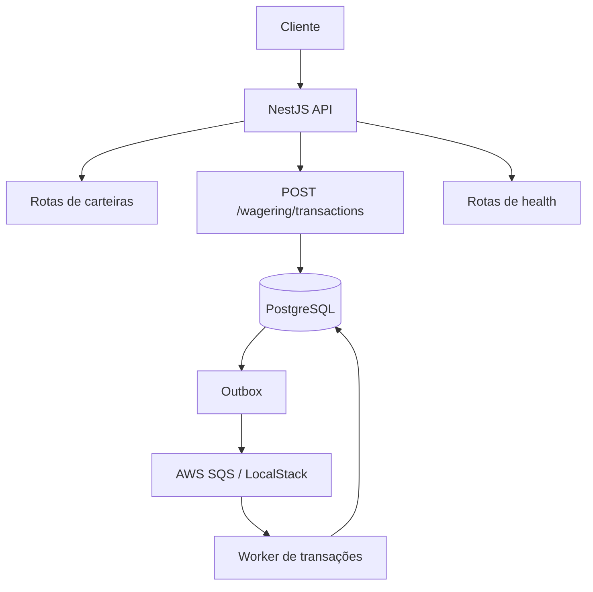

# Distributed Wagering Processor

Processador distribuído de transações usando Bun, TypeScript, NestJS, PostgreSQL, MikroORM e AWS SQS via LocalStack.

## Executar localmente

Requisitos: Bun 1.x, Docker e Docker Compose. 

Configure seu token no [LocalStack](https://app.localstack.cloud/).

```bash
bun install
cp .env.example .env
```

No Windows PowerShell:

```powershell
Copy-Item .env.example .env
```

Configure `LOCALSTACK_AUTH_TOKEN` no `.env`. Não versione esse arquivo.

```bash
docker compose up -d
bun run migration:up
bun run start:dev
```

API: `http://localhost:3000`.

## Rotas

### `POST /wallets`

Cria uma carteira.

**Body**
```json
{
  "playerId": "550e8400-e29b-41d4-a716-446655440000",
  "initialBalance": {
    "amount": "1000.00",
    "currency": "BRL"
  }
}
```

**Resposta `201 Created`**
```json
{
  "id": "550e8400-e29b-41d4-a716-446655440001",
  "playerId": "550e8400-e29b-41d4-a716-446655440000",
  "balance": {
    "amount": "1000.00",
    "currency": "BRL"
  },
  "version": 1,
  "createdAt": "2026-10-12T12:00:00.000Z",
  "updatedAt": "2026-10-12T12:00:00.000Z"
}
```

`409 Conflict` — carteira já existente para jogador e moeda:
```json
{
  "message": "A wallet already exists for this player and currency"
}
```

`400 Bad Request` — body inválido:
```json
{
  "message": "Validation failed",
  "issues": []
}
```

O array `issues` contém os detalhes da validação que falhou.

### `GET /wallets/:walletId`

Consulta uma carteira.

**Resposta `200 OK`**
```json
{
  "id": "550e8400-e29b-41d4-a716-446655440001",
  "playerId": "550e8400-e29b-41d4-a716-446655440000",
  "balance": {
    "amount": "1000.00",
    "currency": "BRL"
  },
  "version": 1,
  "createdAt": "2026-10-12T12:00:00.000Z",
  "updatedAt": "2026-10-12T12:00:00.000Z"
}
```

`404 Not Found`:
```json
{
  "message": "Wallet not found"
}
```

### `GET /wallets/:walletId/ledger`

Consulta o histórico de lançamentos.

**Query params**
- `limit`: quantidade por página, de `1` a `100`; padrão `50`.
- `cursor`: cursor retornado pela página anterior.

Exemplo: `GET /wallets/550e8400-e29b-41d4-a716-446655440001/ledger?limit=20`

**Resposta `200 OK`**
```json
{
  "entries": [
    {
      "id": "550e8400-e29b-41d4-a716-446655440002",
      "walletId": "550e8400-e29b-41d4-a716-446655440001",
      "transactionId": "550e8400-e29b-41d4-a716-446655440003",
      "direction": "CREDIT",
      "amount": {
        "amount": "1000.00",
        "currency": "BRL"
      },
      "balanceBefore": {
        "amount": "0.00",
        "currency": "BRL"
      },
      "balanceAfter": {
        "amount": "1000.00",
        "currency": "BRL"
      },
      "createdAt": "2026-10-12T12:00:00.000Z"
    }
  ],
  "nextCursor": null
}
```

`404 Not Found`:
```json
{
  "message": "Wallet not found"
}
```

### `POST /wallets/:walletId/reconciliation`

Compara o saldo armazenado com o saldo calculado a partir do ledger.

**Body:** nenhum.

**Resposta `200 OK`**
```json
{
  "walletId": "550e8400-e29b-41d4-a716-446655440001",
  "storedBalance": {
    "amount": "1000.00",
    "currency": "BRL"
  },
  "calculatedBalance": {
    "amount": "1000.00",
    "currency": "BRL"
  },
  "difference": {
    "amount": "0.00",
    "currency": "BRL"
  },
  "consistent": true,
  "checkedEntries": 1
}
```

Se a carteira não existir, retorna `404 Not Found` com `{"message":"Wallet not found"}`.

### `POST /wagering/transactions`

Enfileira uma transação para processamento.

**Header obrigatório**
```http
Idempotency-Key: bet-unique-001
```

**Body — exemplo BET**
```json
{
  "providerId": "provider-001",
  "externalTransactionId": "bet-001",
  "playerId": "550e8400-e29b-41d4-a716-446655440000",
  "walletId": "550e8400-e29b-41d4-a716-446655440001",
  "roundId": "round-001",
  "gameId": "game-001",
  "kind": "BET",
  "money": {
    "amount": "25.00",
    "currency": "BRL"
  }
}
```

Tipos aceitos em `kind`: `BET`, `WIN`, `LOSS`, `REFUND`, `ROLLBACK`.

Para `REFUND` e `ROLLBACK`, inclua `referenceExternalTransactionId` com o identificador externo da transação referenciada. Esse campo também é aceito para `WIN`.

**Resposta `202 Accepted` — processamento pendente**
```json
{
  "transactionId": "550e8400-e29b-41d4-a716-446655440003",
  "status": "PENDING",
  "idempotentReplay": false
}
```

**Resposta `200 OK` — resultado já processado**
```json
{
  "transactionId": "550e8400-e29b-41d4-a716-446655440003",
  "status": "PROCESSED",
  "balance": {
    "amount": "975.00",
    "currency": "BRL"
  },
  "idempotentReplay": false
}
```

**Resposta `422 Unprocessable Entity` — transação rejeitada**
```json
{
  "transactionId": "550e8400-e29b-41d4-a716-446655440003",
  "status": "REJECTED",
  "failureCode": "INSUFFICIENT_FUNDS",
  "idempotentReplay": false
}
```

**Possíveis erros HTTP**

| Código | Mensagem | Motivo |
|---|---|---|
| `400` | `Validation failed` | Body ou header inválido; inclui `issues` |
| `400` | `Wager transaction amount must be positive` | Valor não positivo |
| `400` | `REFUND requires a referenced external transaction id` | Referência obrigatória ausente |
| `400` | `ROLLBACK requires a referenced external transaction id` | Referência obrigatória ausente |
| `404` | `Wallet not found` | Carteira inexistente ou incompatível com jogador/moeda |
| `409` | `IdempotencyKey was already used with a different payload` | Mesma chave com conteúdo diferente |
| `409` | `Wager transaction already exists for this provider and external transaction id` | ID externo já utilizado |
| `500` | `Internal server error` | Erro inesperado |

**Possíveis `failureCode` de transação rejeitada**

- `INSUFFICIENT_FUNDS`
- `INVALID_REFERENCE`
- `REFUND_AMOUNT_MISMATCH`
- `REFERENCE_ALREADY_REFUNDED`
- `ROLLBACK_AMOUNT_MISMATCH`
- `REFERENCE_ALREADY_ROLLED_BACK`
- `REFERENCE_TRANSACTION_NOT_FOUND`
- `ROLLBACK_INSUFFICIENT_FUNDS`

Esses códigos são retornados no campo `failureCode` quando a transação é rejeitada. Nem toda rejeição é um erro HTTP de validação.

### `GET /health/live`

**Resposta `200 OK`**
```json
{
  "status": "alive"
}
```

### `GET /health/ready`

Verifica a conectividade com o PostgreSQL.

**Resposta `200 OK`**
```json
{
  "status": "ready",
  "checks": {
    "database": "up"
  }
}
```

**Resposta `503 Service Unavailable`**
```json
{
  "status": "not_ready",
  "checks": {
    "database": "down"
  }
}
```

## Fluxo



## Testes e qualidade

```bash
# Testes unitários
bun run test

# Testes de integração e end-to-end
bun run test:e2e

# Build
bun run build

# Lint
bun run lint

# Formatação
bun run format
```

Os testes de integração utilizam PostgreSQL e LocalStack. Configure `POSTGRES_TEST_DATABASE_URL` para um banco dedicado cujo nome termine em `_test` ou `-test`.

**Nunca aponte essa variável para um banco de desenvolvimento ou produção.**


## Observabilidade

### Logs estruturados

A aplicação utiliza um logger estruturado que emite registros JSON para `stdout` e `stderr`, facilitando a coleta pelo Docker e por ferramentas de centralização de logs.

Os registros podem incluir os seguintes campos:

- `timestamp`, `level`, `context` e `message`;
- `correlationId`, `messageId`, `transactionId`, `walletId` e `providerId`, quando disponíveis.

O middleware HTTP aceita o header `x-correlation-id` quando ele atende ao formato permitido. Caso contrário, gera um UUID e devolve o identificador no header da resposta. O contexto de correlação também é propagado para os comandos enviados pela Outbox.

**Segurança:** não registrar payloads financeiros completos, valores de apostas, saldos, credenciais, tokens ou dados sensíveis de mensagens. Utilize os identificadores de correlação para localizar operações durante uma investigação.

Exemplo:

```bash
curl -H "x-correlation-id: support-case-123" http://localhost:3001/health/live
```

### Métricas

O endpoint `GET /metrics` expõe métricas no formato de texto compatível com Prometheus.

| Métrica | Finalidade |
|---|---|
| `wager_transactions{status="..."}` | Quantidade persistida de transações por status atual |
| `wagering_duplicates_total{source="..."}` | Duplicatas idempotentes detectadas |
| `wagering_retries_total{stage="..."}` | Tentativas de retry por etapa |
| `wagering_dlq_messages{queue="..."}` | Profundidade aproximada da fila de mensagens mortas |
| `wagering_lock_conflicts_total` | Conflitos de lock ou serialização no PostgreSQL |
| `wagering_outbox_lag_seconds` | Idade do comando mais antigo aguardando publicação |
| `wagering_transaction_processing_duration_seconds` | Distribuição da duração do processamento |

O endpoint atualiza algumas métricas consultando o PostgreSQL e a DLQ. Portanto, a coleta também depende da disponibilidade dessas dependências.

Não utilize IDs de transação, carteira ou correlação como labels das métricas. Esses valores possuem alta cardinalidade e devem permanecer nos logs.

### Health checks

- `GET /health/live`: indica que o processo HTTP está ativo, sem consultar dependências externas.
- `GET /health/ready`: verifica PostgreSQL, fila de comandos e DLQ. Retorna `200 OK` quando todas estão acessíveis e `503 Service Unavailable` quando alguma dependência está indisponível.

Liveness e readiness têm finalidades diferentes: uma instância pode continuar viva, mas não estar pronta para atender requisições.

## Migrations

O schema do PostgreSQL é gerenciado por migrations versionadas do MikroORM.

```bash
# Criar uma migration em branco
bun run migration:create

# Aplicar migrations pendentes
bun run migration:up

# Reverter a última migration
bun run migration:down
```

Revise o SQL de cada migration antes de aplicá-la. As alterações precisam preservar as constraints financeiras e oferecer uma reversão coerente.

O ledger é protegido contra alterações e exclusões por trigger no PostgreSQL. Não remova essa proteção para facilitar operações de manutenção.

## Consistência financeira

As garantias centrais são implementadas no domínio e no PostgreSQL:

- Valores monetários são representados por strings decimais e pelo Value Object `Money`, sem cálculos financeiros com `number` de JavaScript.
- A idempotência é persistida no banco e protegida por constraints de unicidade.
- O processamento utiliza transações PostgreSQL e lock pessimista na carteira específica, permitindo concorrência entre carteiras diferentes.
- Saldo, transação financeira, lançamento no ledger e eventos relacionados são persistidos atomicamente.
- O ledger é append-only e protegido contra `UPDATE` e `DELETE` por trigger.
- Inbox e Outbox permitem recuperação após falhas e reentregas sem depender exclusivamente da deduplicação FIFO do SQS.
- A reconciliação compara o saldo armazenado com o calculado a partir do ledger, sem corrigir divergências silenciosamente.

Consulte [`docs/ARCHITECTURE.md`](docs/ARCHITECTURE.md) para conhecer os detalhes das entidades, dos casos de uso e das decisões de persistência.

## Próximas evoluções

A prioridade é concluir e validar todos os requisitos obrigatórios do desafio, incluindo concorrência, idempotência, recuperação de falhas, testes de integração e observabilidade.

OpenTelemetry para tracing distribuído e Keycloak para autenticação e autorização são evoluções planejadas. Não devem ser considerados implementados apenas por constarem neste roadmap.

